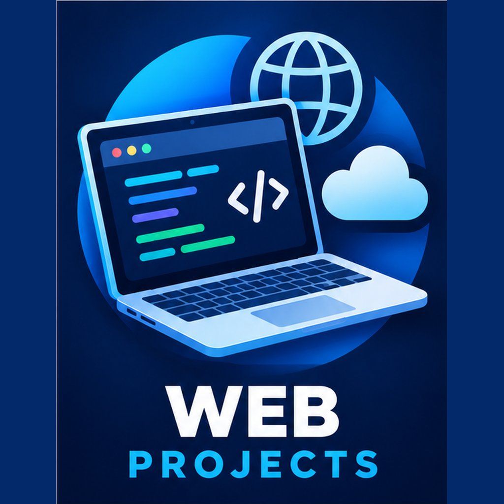
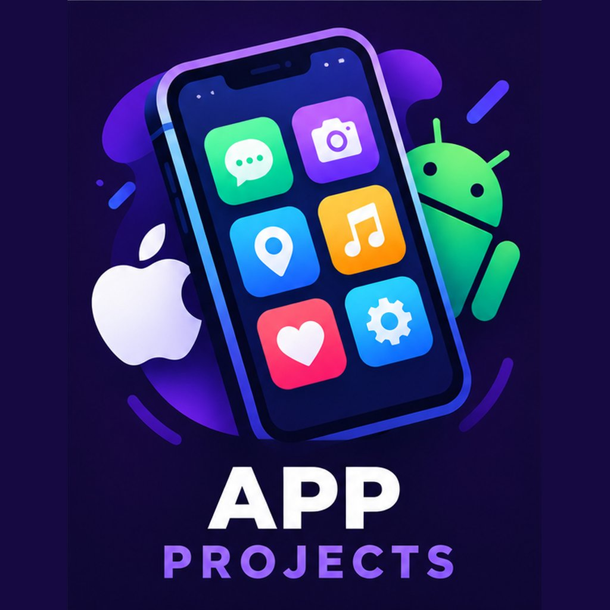
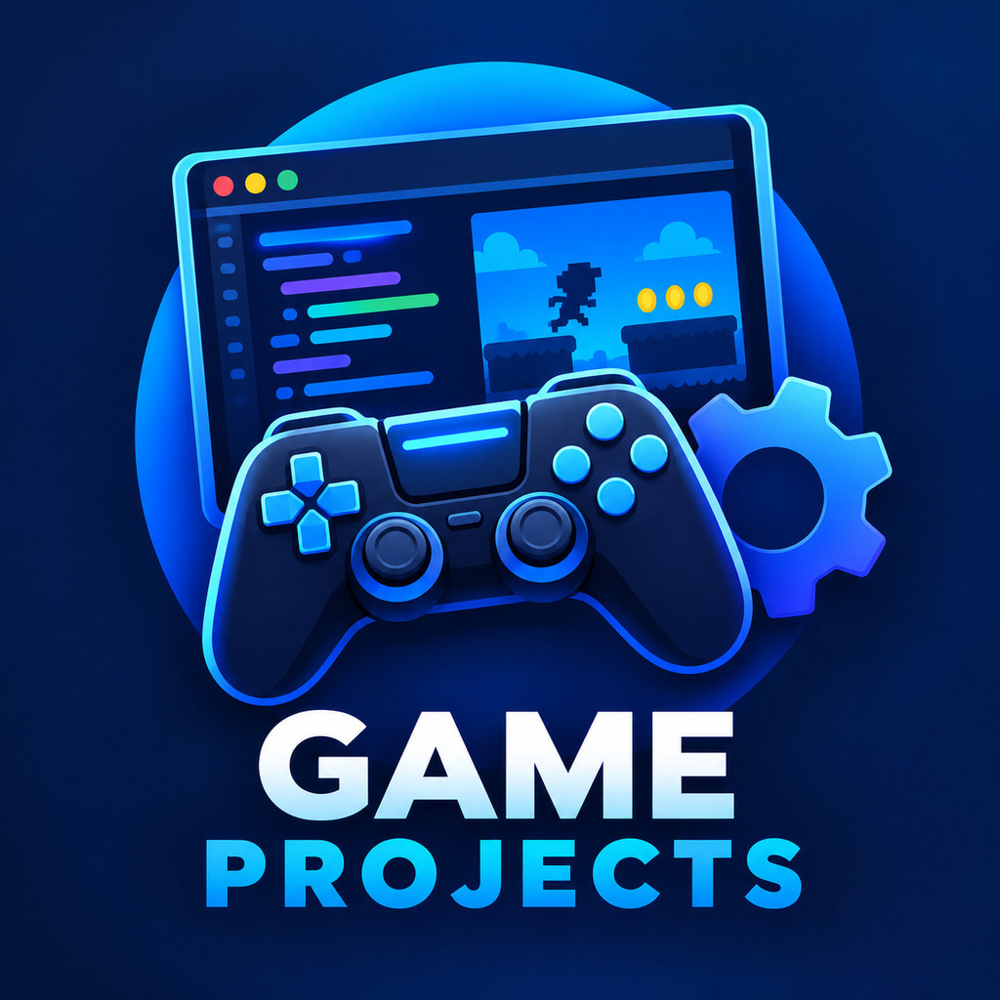
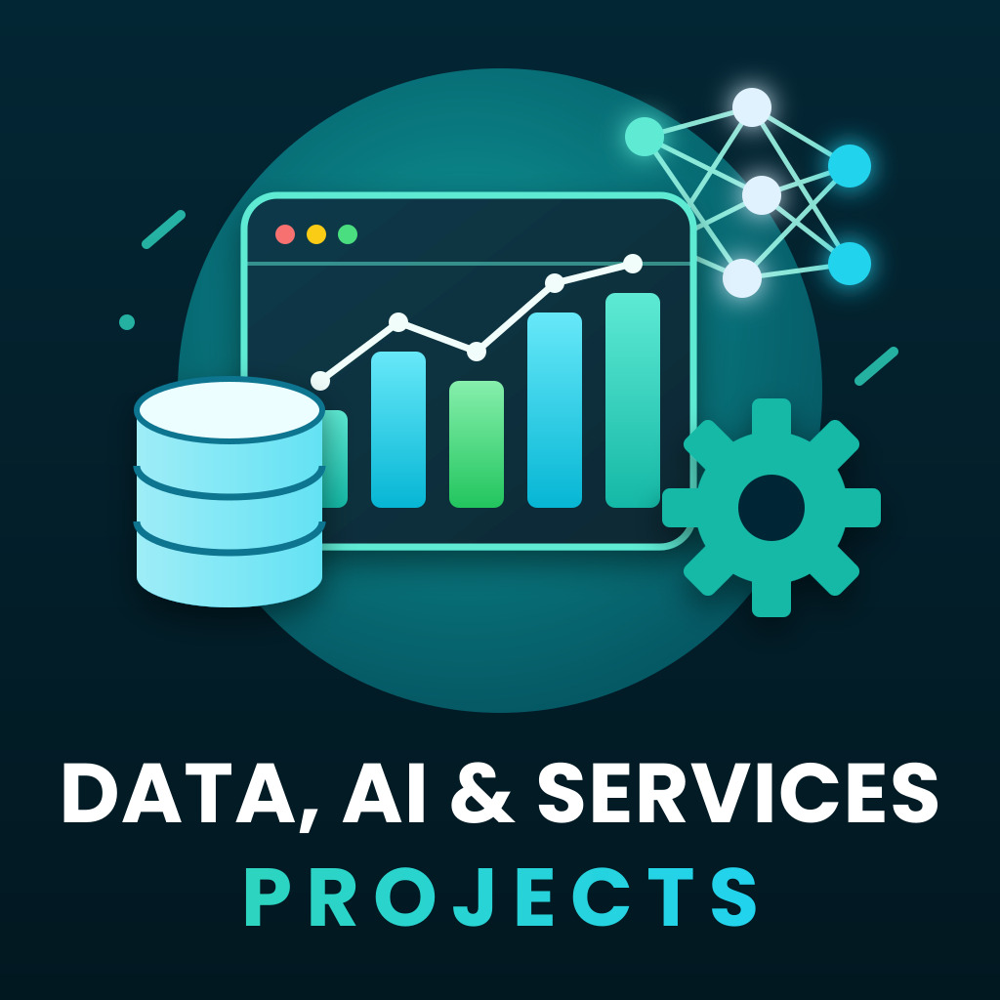

# 👋 Hi, I'm Adrián

### Junior Full Stack Developer · Multiplatform Application Developer · AI & Big Data student

---

 

## 🧑‍💻 About Me

I'm a junior full stack software developer with a Higher Technician degree in Multiplatform Application Development (DAM). I enjoy building complete applications, from the backend to the frontend and mobile. I'm currently expanding my skills in Artificial Intelligence and Big Data through an in-person specialization course, and on my own I'm also learning Godot Engine to get into game development.

> 💡 **From idea to deployment**: I like taking a project through every stage of its life.

- 🎓 **Education:** Higher Technician in Multiplatform Application Development (DAM)
- 💼 **Role:** Junior Full Stack Developer
- 🌱 **Currently learning:**
  - 🤖 Specialization course in **Artificial Intelligence & Big Data** (in person)
  - 🎮 **Game development with Godot Engine**, on my own

---

 

## 🛠️ Tech Stack

| Area | Technologies |
|------|--------------|
| ⚙️ **Backend** |     |
| 📊 **Data & AI** |  |
| 🎨 **Frontend** |  |
| 📱 **Mobile** |  |
| 🗄️ **Database** |    |
| ☁️ **Deployment** |   |
| 🔧 **Version Control** |   |
| 🧰 **IDEs & Editors** |    |

---

 

## 📂 Projects

  

| Project | Description | Links |
|---------|-------------|-------|
| 🖥️ **Portfolio XP** | Personal portfolio that recreates the Windows XP experience, built with Angular | 🔗 [Repository](https://github.com/adrianpmdev/Portfolio) · 🌐 [Live Demo](https://adrianpmdev-portfolio.vercel.app/) |
| 📋 **Task Manager** | Web app to organize clients and track their tasks | 🔗 [Repository](https://github.com/adrianpmdev/task-manager) |

 

  

| Project | Description | Links |
|---------|-------------|-------|
| 🗓️ **EventvsMerida** | Mobile app that brings together the cultural and leisure agenda of Mérida, developed as a team | 🔗 [Repository](https://github.com/Null-Pointers-Albarregas/EventvsMerida) |
| ⏱️ **Time Tracker** | Mobile app to log the hours spent on each project | 🔗 [Repository](https://github.com/adrianpmdev/time-tracker) |

 

  

| Project | Description | Links |
|---------|-------------|-------|
| 🕹️ **Coming soon** | Learning game development with Godot Engine | |

 

  

| Project | Description | Links |
|---------|-------------|-------|
| 🔗 **Link Checker** | Service that periodically checks that product links still work | 🔗 [Repository](https://github.com/adrianpmdev/link-checker) |
| 📊 **Click Reports** | Service that turns product clicks into simple statistics and CSV reports | 🔗 [Repository](https://github.com/adrianpmdev/click-reports) |

---

 

✨ Thanks for stopping by! ✨

